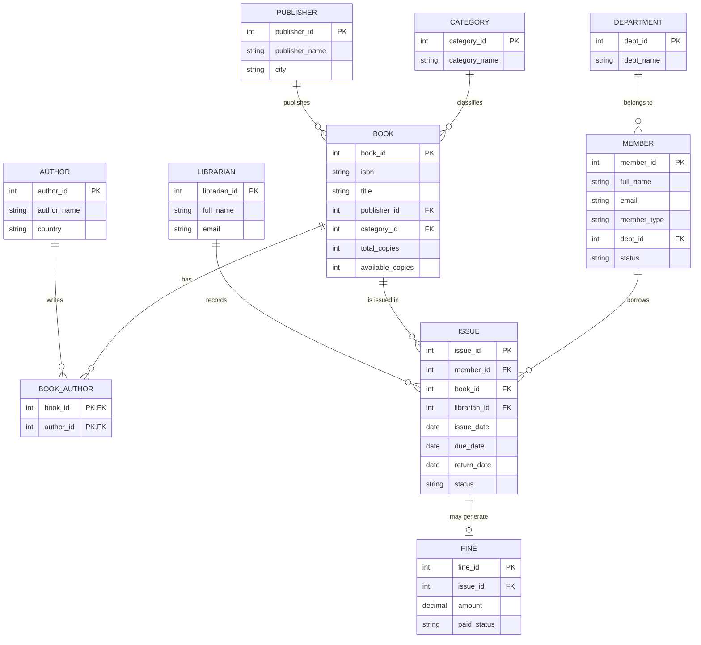

# College Library & Book Circulation System

A full DBMS mini-project: **MySQL** database (3NF) + **Node.js/Express** REST API + **HTML/CSS/JS** frontend.

```
library-system/
├── database/
│   ├── schema.sql     # tables, constraints, indexes, views, stored procedures (transactions)
│   ├── seed.sql       # sample data
│   └── queries.sql    # CRUD, reports, transaction demos (run these in the viva)
├── backend/           # Express API + MySQL connection (server.js, db.js, .env.example)
└── frontend/          # Web UI (served by the backend, or hosted separately)
```

---
## 1. How to run (5 steps)

**Install once:** [Node.js 18+](https://nodejs.org) and [MySQL 8.0+](https://dev.mysql.com/downloads/mysql/) (remember the root password you set).

**Step 1 – Create the database.** Open a terminal in the project folder:
```bash
mysql -u root -p < database/schema.sql
mysql -u root -p < database/seed.sql
```
*(MySQL Workbench alternative: File → Open SQL Script → `schema.sql` → press the lightning ⚡ button, then do the same for `seed.sql`.)*

**Step 2 – Connect the backend to MySQL.**
```bash
cd backend
cp .env.example .env        # Windows: copy .env.example .env
```
Open `.env` and set your password: `DB_PASSWORD=your_mysql_password`

**Step 3 – Install and start.**
```bash
npm install
npm start
```
You should see `Library system running at http://localhost:5000`.

**Step 4 – Open the app:** http://localhost:5000 (the backend also serves the frontend, so there is only one thing to run).

**Step 5 – Try it:** Issue a book, return the overdue one (a fine is created automatically), open Reports.

### How the SQL connection works
`backend/db.js` creates a **connection pool** with the `mysql2` library using the values in `.env`.
`server.js` receives HTTP requests from the frontend (`fetch('/api/books')`), runs SQL through the pool, and returns JSON.
Frontend → **HTTP/JSON** → Express → **SQL** → MySQL.

### Troubleshooting
| Problem | Fix |
|---|---|
| `ER_ACCESS_DENIED_ERROR` | Wrong `DB_PASSWORD` / `DB_USER` in `.env` |
| `Client does not support authentication protocol` | In MySQL: `ALTER USER 'root'@'localhost' IDENTIFIED WITH mysql_native_password BY 'yourpass';` |
| `ER_BAD_DB_ERROR` | Step 1 not done – run `schema.sql` |
| `ECONNREFUSED 3306` | MySQL service is not running (start it from Services / `brew services start mysql`) |
| Port 5000 busy | Change `PORT` in `.env` |

---
## 2. Entities, attributes and keys

| Entity | Attributes (PK underlined by `PK`, FK marked) |
|---|---|
| **Department** | `dept_id` PK, dept_name |
| **Category** | `category_id` PK, category_name |
| **Publisher** | `publisher_id` PK, publisher_name, city |
| **Author** | `author_id` PK, author_name, country |
| **Book** | `book_id` PK, isbn (unique), title, publish_year, shelf_location, total_copies, available_copies, `publisher_id` FK, `category_id` FK |
| **Book_Author** | (`book_id` FK, `author_id` FK) composite PK — resolves the M:N |
| **Member** | `member_id` PK, full_name, email (unique), phone, member_type, join_date, status, `dept_id` FK |
| **Librarian** | `librarian_id` PK, full_name, email |
| **Issue** | `issue_id` PK, issue_date, due_date, return_date, status, `member_id` FK, `book_id` FK, `librarian_id` FK |
| **Fine** | `fine_id` PK, `issue_id` FK (unique), amount, paid_status, fine_date |

### Relationships
- Department **1:N** Member · Category **1:N** Book · Publisher **1:N** Book
- Book **M:N** Author (via Book_Author)
- Member **1:N** Issue · Book **1:N** Issue · Librarian **1:N** Issue (Issue is the associative entity between Member and Book)
- Issue **1:0..1** Fine

## 3. ER diagram
(Renders on GitHub / VS Code with a Mermaid extension. To get a PNG for your report, paste it into https://mermaid.live and click *Download PNG*.)



## 4. Functional dependencies
- Department: `dept_id → dept_name` and `dept_name → dept_id`
- Category: `category_id → category_name`
- Publisher: `publisher_id → publisher_name, city`
- Author: `author_id → author_name, country`
- Book: `book_id → isbn, title, publisher_id, category_id, publish_year, shelf_location, total_copies, available_copies`; `isbn → book_id` (candidate key)
- Member: `member_id → full_name, email, phone, member_type, dept_id, join_date, status`; `email → member_id`
- Librarian: `librarian_id → full_name, email`
- Issue: `issue_id → member_id, book_id, librarian_id, issue_date, due_date, return_date, status`
- Fine: `fine_id → issue_id, amount, paid_status, fine_date`; `issue_id → fine_id`
- Book_Author: only the trivial dependency on its composite key `(book_id, author_id)`

## 5. Normalization to 3NF
**Unnormalized (UNF)** – one big sheet:
`Issue(issue_id, issue_date, due_date, return_date, member_name, member_email, member_dept, book_title, isbn, authors[ ], category, publisher, publisher_city, librarian, fine_amount)`

**1NF** – remove repeating groups: `authors[ ]` holds many values in one cell. Every cell becomes atomic; the authors move to their own rows (later the `Book_Author` table). Primary key chosen: `issue_id`.

**2NF** – remove partial dependencies. Once authors are split, the key is `(issue_id, author)`; yet `member_name`, `book_title`, `due_date` depend on only part of it. They are separated into `Member`, `Book`, `Issue`, `Author`, `Book_Author`.

**3NF** – remove transitive dependencies (non-key → non-key):
| Transitive dependency found | Fix |
|---|---|
| `book_id → publisher_id → publisher_city` | `Publisher` table |
| `book_id → category_id → category_name` | `Category` table |
| `member_id → dept_id → dept_name` | `Department` table |
| `issue_id → librarian_id → librarian_name` | `Librarian` table |
| `issue_id → fine_amount` (only some issues have fines) | `Fine` table |

In every final table each non-key attribute depends on **the key, the whole key, and nothing but the key** – so all 10 tables are in **3NF** (and BCNF, because every determinant is a candidate key).

> `available_copies` is a *derived* value kept deliberately for fast availability checks; it is only changed inside transactions, so it can never drift.

## 6. Features mapped to requirements
| Requirement | Where |
|---|---|
| CRUD | Books, Members, Authors/Publishers/Categories/Departments pages ↔ `backend/server.js` ↔ `database/queries.sql` |
| Views / reports | `v_book_catalog`, `v_current_issues`, `v_overdue_books`, `v_member_summary`, `v_popular_books`, `v_fine_report`, `v_category_stock` → *Reports* page |
| Transactions | `sp_issue_book`, `sp_return_book` (`START TRANSACTION … COMMIT`, auto `ROLLBACK` on error), plus book-with-authors insert in `server.js` |
| Constraints | PK, FK (RESTRICT/CASCADE), UNIQUE, CHECK (stock ≥ 0, due ≥ issue), ENUM, NOT NULL, indexes |

### Business rules
Loan period 14 days · students borrow max 3, faculty max 5 · fine ₹2/day when late · suspended members cannot borrow · same member cannot hold two copies of one title.

## 7. Transaction demonstration (for the viva)
Run in MySQL Workbench / CLI (`database/queries.sql` has it ready):
```sql
-- A. COMMIT: both statements saved together
START TRANSACTION;
  INSERT INTO issue(member_id,book_id,librarian_id,issue_date,due_date)
         VALUES (4,4,1,CURDATE(),DATE_ADD(CURDATE(),INTERVAL 14 DAY));
  UPDATE book SET available_copies = available_copies - 1 WHERE book_id = 4;
COMMIT;

-- B. ROLLBACK: change is undone
START TRANSACTION;
  UPDATE book SET available_copies = available_copies - 1 WHERE book_id = 5;
ROLLBACK;                               -- stock is back to the original value

-- C. Stored procedure: the second call fails and rolls back automatically
CALL sp_issue_book(5, 6, 1);            -- success
CALL sp_issue_book(5, 6, 1);            -- ERROR: Member already holds a copy of this book
```
In the web app: *Issue & return* → issue the same book twice to the same member and watch the error appear while the stock stays correct.
`SELECT … FOR UPDATE` locks the rows so two librarians cannot issue the last copy at the same time (**ACID**: Atomicity, Consistency, Isolation, Durability).

---
## 8. Deployment
**Easiest (one service):** the backend serves the frontend, so deploy only the backend.
1. **Database:** create a free MySQL on [Railway](https://railway.app) or [Aiven](https://aiven.io); import `schema.sql` then `seed.sql` (remove the first two lines `DROP DATABASE… / CREATE DATABASE…` + `USE library_db;` if the host gives you a fixed database name).
2. **Backend + frontend:** push the folder to GitHub → create a *Web Service* on [Render](https://render.com): root = `backend`, build `npm install`, start `npm start`.
3. Add environment variables from `.env.example` (`DB_HOST`, `DB_PORT`, `DB_USER`, `DB_PASSWORD`, `DB_NAME`). Open the Render URL – done.

**Separate frontend (optional):** host `frontend/` on Netlify/Vercel and set `window.API_BASE = "https://your-backend.onrender.com"` in `frontend/config.js`.

**Using SQL Server instead of MySQL?** This project targets MySQL. SQL Server needs `mssql` in place of `mysql2` and T-SQL syntax for the procedures – say so in your report only if your syllabus demands it.

## 9. Likely viva questions
- *Why is `Book_Author` needed?* Book–Author is M:N; a junction table keeps 1NF.
- *Why a separate `Fine` table?* Not every issue has a fine; keeping it in `Issue` would create NULLs and a transitive dependency.
- *What if two people issue the last copy together?* `FOR UPDATE` row lock + `CHECK (available_copies >= 0)`.
- *Why views?* Reusable, simplified, read-only reports that hide joins.
- *Primary vs foreign key?* PK uniquely identifies a row; FK references another table's PK to enforce referential integrity.
